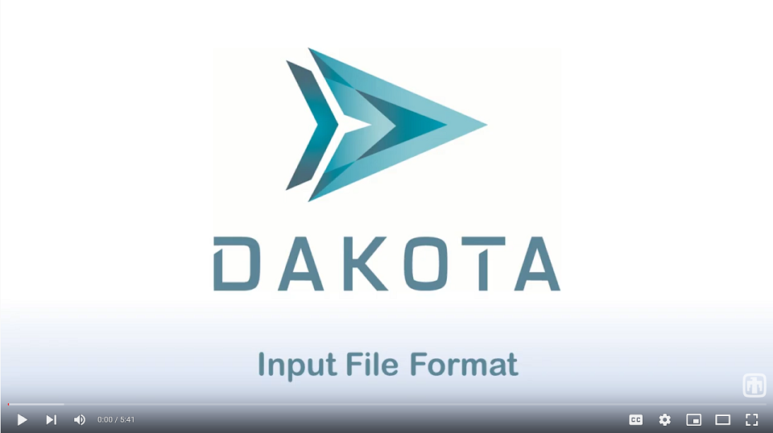
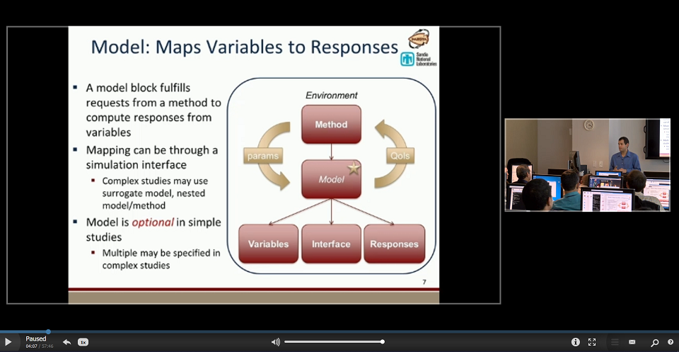

.. _inputfile-main:

.. _`topic-block`:

"""""""""""""""""
Dakota Input File
"""""""""""""""""

.. toctree::
   :maxdepth: 1
   
   inputfile/formatting
   inputfile/json
   inputfile/model
   inputfile/variables
   inputfile/interfaces
   inputfile/responses
   inputfile/inputstodakota
   inputfile/inputspec   

For an introduction to the six blocks of an input file and how they fit
together, start with :ref:`studyanatomy-main`. The pages listed above cover
each part of the input file in depth, and the two input formats,
:ref:`JSON <jsoninput>` and :ref:`freeform <inputfile_formatting_main>`, have
a page each. For video resources on the input file, see
:ref:`inputfile-videos`.

==================
The six blocks
==================

- **Environment** (optional, at most one): settings for the whole study, such
  as tabular data output (:dakkw:`environment-tabular_data`), Dakota's
  graphical output (:dakkw:`environment-graphics`), and, in advanced studies,
  the method that runs first (:dakkw:`environment-top_method_pointer`). See
  :dakkw:`environment`.
- **Method** (at least one): the algorithm and its options. Several method
  blocks can appear in :ref:`advanced studies <adv_meth>`. See
  :ref:`studytypes-main` and :dakkw:`method`.
- **Model** (optional in simple studies): how variables are mapped through an
  interface to responses. Surrogate-based studies and optimization under
  uncertainty need more than one model. See :ref:`models:main`.
- **Variables** (at least one): the parameters Dakota varies, classified as
  design, uncertain or state variables, each continuous or discrete. See
  :ref:`variables:main`.
- **Interface** (at least one): how Dakota runs each evaluation, either a
  function linked into Dakota (``direct``) or an external analysis driver run
  with ``fork`` or ``system``. See :ref:`interfaces:main`,
  :ref:`couplingtosimulations-main` and :ref:`advint`.
- **Responses** (at least one): the responses returned to Dakota (objective
  functions, calibration terms or response functions), any constraints, and
  whether derivatives are available. See :ref:`responses:main`.

To see a complete example input file and its results, see
:ref:`examples-gettingstarted-rosenbrock`.

.. _inputfile-videos:

===============
Video Resources
===============

+--------------------------------+-----------------+----------------+
| Title                          | Link            | Resources      |
+================================+=================+================+
| Input File Format              | |Screencast|_   |                |
+--------------------------------+-----------------+----------------+
| Input Syntax / Building Blocks | |Training|_     | `Slides`__ /   |
|                                |                 | `Exercises`__  |
+--------------------------------+-----------------+----------------+

.. __: https://dakota.sandia.gov/sites/default/files/training/DakotaTraining_InputComponents.pdf
__ https://dakota.sandia.gov/sites/default/files/training/input-151215.zip

.. _Screencast: https://www.youtube.com/watch?v=f1l8DIXd9Gs&list=PLouetuxaIMDo-NMFXT-hlHYhOkePLrayY&index=2

.. _Training: http://digitalops.sandia.gov/Mediasite/Play/16134f3f4b6842d2b145a9600cbbcbbd1d
