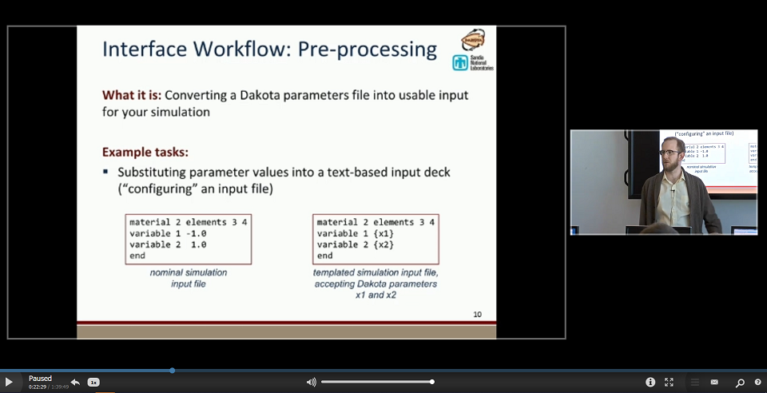
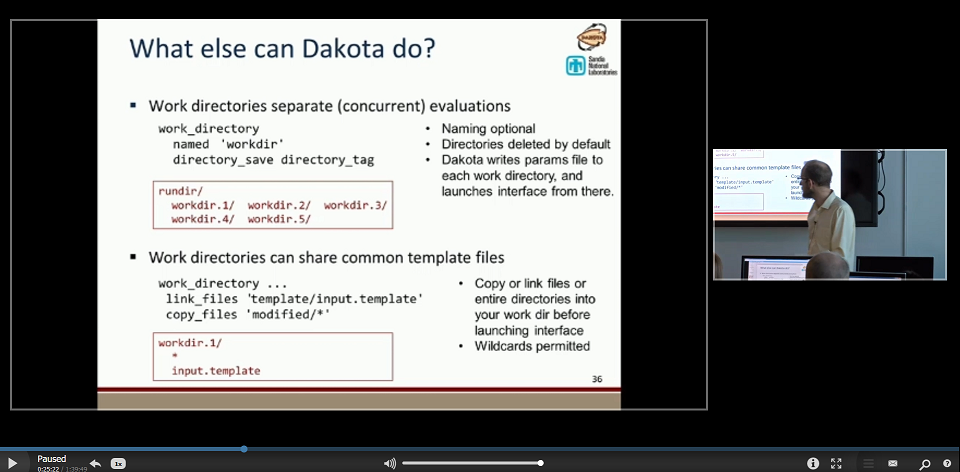

.. _couplingtosimulations-main:

""""""""""""""""""""""""""""""""""""""""""
Connecting Your Code: The Analysis Driver
""""""""""""""""""""""""""""""""""""""""""

To connect Dakota with your simulation, you provide one :term:`analysis driver`: 
a program that Dakota runs once for each :term:`evaluation`. In the most common 
interfacing format, Dakota gives the analysis driver two file names as arguments, 
a :term:`parameters file` to read and a :term:`results file` to write. Analysis
drivers are most often scripts (e.g., Python, MATLAB, Bash or Powershell), but
you can also build one graphically in the Dakota GUI.

This page builds an analysis driver for a black-box version of the Rosenbrock
example from :ref:`studyanatomy-rosenbrock`. Instead of using the function
built into Dakota, it runs ``rosenbrock_bb.py``, a small program that behaves
like an engineering simulation code: it reads an input deck, ``ros.in``, and
writes a log, ``ros.out``.

.. figure:: /usingdakota/img/intro/analysis_driver_flow.*
   :name: coupling:figure01
   :alt: For each evaluation, Dakota writes a parameters file. The analysis
         driver pre-processes it with ros.template and dprepro into ros.in,
         runs rosenbrock_bb.py, and post-processes ros.out into a results file,
         which Dakota reads.
   :align: center

   Common steps for a single evaluation with an analysis driver: pre-processing to generate,
   a valid input file for the simulation code, running the simulation, and post-processing to 
   extract responses to return to Dakota. 

.. _couplingtosimulations-jobs:

=======================================
The three jobs of an analysis driver
=======================================

Every analysis driver does the same three things, in order:

1. **Pre-process.** Put this evaluation's parameter values into your code's
   input. The usual way is a :term:`template file`: a copy of your input file
   with placeholders, such as ``{x1}``, that :term:`dprepro` or :term:`pyprepro` 
   fills in with the values from the :term:`parameters file`.
2. **Run.** Run your simulation code.
3. **Post-process.** Extract the :term:`responses` from your code's output, and
   write them to the :term:`results file`.

.. _couplingtosimulations-files:

======================================
What Dakota writes and what it expects
======================================

For each evaluation, Dakota writes a parameters file. Here is the first one
from the Rosenbrock parameter study, where ``x1`` and ``x2`` are both -2:

.. code-block:: none

                         2 variables
    -2.000000000000000e+00 x1
    -2.000000000000000e+00 x2
                         1 functions
                         1 ASV_1:response_fn_1
                         2 derivative_variables
                         1 DVV_1:x1
                         2 DVV_2:x2
                         0 analysis_components
                         1 eval_id

The first lines give the variable values, each followed by its name. The
``1`` in front of ``ASV_1:response_fn_1`` means Dakota wants the value of the
first response. The remaining lines matter only for more advanced studies,
such as those that need derivatives. You rarely need to read this file
yourself: ``dprepro`` and the ``dakota.interfacing`` Python module read it for
you.

Your analysis driver writes a results file with one line per response,
holding its value. The name after the value is optional:

.. code-block:: none

   3.6090000000000000e+03 response_fn_1

Learn more: :ref:`couplingtosimulations-paramformat`,
:ref:`responses:results`.

.. _couplingtosimulations-minimal:

===========================
A minimal analysis driver
===========================

Here is a complete analysis driver for the black-box Rosenbrock example, in
three languages. Each version does the same three jobs, under the same
headings. Choose the tab for the language you want to use.

.. include:: analysis_driver_tabs.inc

The template, ``ros.template``, is a copy of the simulation's input deck with
placeholders where the variable values go. Its last lines are:

.. code-block:: none

   variable 1 {x1}
   variable 2 {x2}
   end

**Prefer a graphical tool?** You can build an analysis driver as a workflow in
the Dakota GUI's :ref:`Next-Gen Workflow <ngw-main>` tool instead of writing a
script. If your code reads a text input file, the GUI's
:ref:`Markup File tool <gui-context-tools-markup>` helps you create the
template, and the GUI can also read your model's parameters and responses
from :ref:`INI, JSON or YAML files <gui-simulation-models-ini-json-yaml>`.

.. _couplingtosimulations-interface:

=====================================
Telling Dakota about the driver
=====================================

You point Dakota to your analysis driver in the :term:`interface` block. 
The value of ``analysis_drivers`` is the command Dakota runs, which depends on the
driver's language:

.. list-table::
   :header-rows: 1
   :widths: 30 70

   * - Analysis driver
     - ``analysis_drivers`` value
   * - Python
     - ``'python3 driver.py'``
   * - Bash
     - ``'driver.sh'``
   * - Windows (PowerShell)
     - ``'powershell.exe -File driver.ps1'``

On Linux and macOS, a Python driver that starts with ``#!/usr/bin/env python3``
and is executable can also be named directly, as ``'driver.py'``.

A complete interface block that runs the Python driver looks like this:

.. tab:: JSON

   .. code-block:: json

      {
        "interface": [
          {
            "analysis_drivers": {
              "drivers": ["python3 driver.py"],
              "interface_type": {
                "fork": {
                  "parameters_file": "params.in",
                  "results_file": "results.out",
                  "file_save": true,
                  "work_directory": {
                    "named": "workdir",
                    "directory_tag": true,
                    "directory_save": true,
                    "link_files": ["templatedir/*"]
                  }
                }
              }
            },
            "concurrency": {
              "asynchronous": {
                "evaluation_concurrency": 4
              }
            }
          }
        ]
      }

.. tab:: Freeform

   .. code-block:: dakota

      interface
        analysis_drivers = 'python3 driver.py'
          fork
            parameters_file = 'params.in'
            results_file = 'results.out'
            file_save
            work_directory
              named 'workdir'
              directory_tag
              directory_save
              link_files = 'templatedir/*'
        asynchronous
          evaluation_concurrency = 4

Here is what each part does:

- :dakkw:`fork <interface-analysis_drivers-fork>` runs the analysis driver as
  a separate process, and exchanges data with it through files.
- :dakkw:`parameters_file <interface-analysis_drivers-fork-parameters_file>`
  and :dakkw:`results_file <interface-analysis_drivers-fork-results_file>`
  name those files. Without them, Dakota uses temporary names.
- :dakkw:`file_save <interface-analysis_drivers-fork-file_save>` keeps the
  parameters and results files after each evaluation, which helps when you're
  debugging.
- :dakkw:`work_directory <interface-analysis_drivers-fork-work_directory>`
  runs each evaluation in its own folder, here ``workdir.1``, ``workdir.2``
  and so on (``named`` sets the name, ``directory_tag`` adds the number). That
  keeps evaluations from overwriting each other's files.
  :dakkw:`link_files <interface-analysis_drivers-fork-work_directory-link_files>`
  links the files every evaluation needs into each folder: here, everything
  in the ``templatedir`` folder (the driver, the template and the
  simulation). ``copy_files`` copies them instead.
  ``directory_save`` keeps the folders afterwards.
- :dakkw:`asynchronous <interface-asynchronous>` with
  :dakkw:`evaluation_concurrency <interface-asynchronous-evaluation_concurrency>`
  runs up to four evaluations at the same time.

In the JSON format, ``asynchronous`` sits inside a ``concurrency`` group key.
See :ref:`jsoninput:groupkeys`.

Learn more: :ref:`interfaces:main`, :ref:`interfaces:file`.

.. _couplingtosimulations-testing:

===============================================
Test your analysis driver before running Dakota
===============================================

Run your analysis driver by hand on a sample parameters file before you run a
whole study. Save the parameters file shown above as ``params.in``, in the
folder with your driver, template and simulation, and run:

.. tab:: Python

   .. code-block:: console

      python3 driver.py params.in results.out

.. tab:: Bash

   .. code-block:: console

      ./driver.sh params.in results.out

.. tab:: Windows (PowerShell)

   .. code-block:: console

      powershell.exe -File driver.ps1 params.in results.out

Then check that ``results.out`` holds the value 3609, which is the Rosenbrock
function at (-2, -2).

If it doesn't work, check these common problems:

- **Permissions.** On Linux and macOS, a driver you name directly, such as
  ``driver.sh``, must be executable (``chmod +x driver.sh``) and start with a
  ``#!`` line.
- **Python command.** Some systems have ``python3`` but no ``python``. Use
  the command that exists on yours, and use ``dprepro3`` instead of
  ``dprepro`` if there's no ``python``.
- **Finding Dakota's tools.** ``dprepro`` must be on your ``PATH``, and the
  ``dakota.interfacing`` module must be on your ``PYTHONPATH``. See
  :ref:`setupdakota-environment`.
- **Paths inside work directories.** Each evaluation runs in its own folder,
  so relative paths to your template or simulation must work from there. Use
  ``link_files`` or ``copy_files`` to put them in place.
- **Results file format.** One value per line, one line per response, in the
  order of the responses block.
- **Where to look when an evaluation fails.** Dakota's console output shows
  the failing evaluation. With ``file_save`` and ``directory_save``, its
  parameters file, results file and the simulation's own output stay behind
  for you to inspect.

.. _couplingtosimulations-other:

=======================
Other ways to connect
=======================

A file-based analysis driver works with nearly any code in any language, so
it's where most users start. Dakota can also connect to your code in other
ways:

.. list-table::
   :header-rows: 1
   :widths: 24 26 50

   * - Approach
     - How data moves
     - When to use it
   * - Analysis driver with ``fork`` or ``system``
     - Through files
     - Any code in any language. The default, and the focus of this page.
   * - :ref:`Python direct interface <advint:existingdirect:python>`
     - In memory, via ``Parameters`` and ``Results`` objects
     - Models already written in Python; very many or very fast evaluations,
       where file and process overhead dominates; returning analytic
       gradients. Use the ``@python_interface`` decorator from
       ``dakota.interfacing`` for the friendliest API.
   * - :ref:`Library API <library-api>`
     - In memory, through C++ or Python calls
     - Embedding Dakota in your own application.

With the Python direct interface, Dakota calls a function in your Python
module, with no parameters or results files. The recommended way to write
that function is with the ``@python_interface`` decorator from
``dakota.interfacing``, which passes friendly :class:`Parameters` and
:class:`Results` objects instead of raw dictionaries. Here is the same
Rosenbrock function, in a file named ``rosen_direct.py``:

.. code-block:: python

   import dakota.interfacing as di

   @di.python_interface
   def rosenbrock(params, results):
       x1 = params["x1"]
       x2 = params["x2"]
       results["response_fn_1"].function = 100.0 * (x2 - x1**2)**2 + (1.0 - x1)**2
       return results

The decorator handles all translation between Dakota's native parameter and
result dictionaries and the higher-level objects, so your function works
directly with named variables and named responses.

The interface block names the module and function, and selects ``python``
instead of ``fork``:

.. tab:: JSON

   .. code-block:: json

      {
        "interface": [
          {
            "analysis_drivers": {
              "drivers": ["rosen_direct.rosenbrock"],
              "interface_type": {
                "python": {}
              }
            }
          }
        ]
      }

.. tab:: Freeform

   .. code-block:: dakota

      interface
        analysis_drivers = 'rosen_direct.rosenbrock'
          python

This short function returns only function values, which is enough for
studies that don't ask for derivatives. The Python direct interface may not
be included in pre-built downloads, and must be enabled when compiling Dakota
from source.

.. _couplingtosimulations-next:

==========
Next steps
==========

- :ref:`analysisdriverdeepdive-main` covers the parameters file format in
  detail, a compiled analysis driver, and tighter forms of coupling.
- :ref:`interfaces:building` shows more ways to pre-process and post-process
  files, and :ref:`interfaces:dakota.interfacing` documents the Python module.
- The :ref:`cantilever beam example <additional:cantilever>` is a more
  realistic engineering example, with several responses.

.. _couplingtosimulations-videos:

===============
Video Resources
===============

+-------------------------------------------------------+-----------------+----------------+
| Title                                                 | Link            | Resources      |
+=======================================================+=================+================+
| Interfacing a User's Simulation to Dakota (Part 1)    | |Training1|_    | `Slides`__ /   |
|                                                       |                 | `Exercises`__  |
+-------------------------------------------------------+-----------------+----------------+
| Interfacing a User's Simulation to Dakota (Part 2)    | |Training2|_    |                |
+-------------------------------------------------------+-----------------+----------------+

.. __: https://dakota.sandia.gov/sites/default/files/training/DakotaTraining_Interfacing.pdf
__ https://dakota.sandia.gov/sites/default/files/training/interfacing-151215.zip

.. _Training1: http://digitalops.sandia.gov/Mediasite/Play/82fa69553ac64d9b997a59316100d23a1d

.. _Training2: http://digitalops.sandia.gov/Mediasite/Play/5c5f47304b934159a40347f3ba74ad851d

**Next:** :ref:`helloworld-main`
