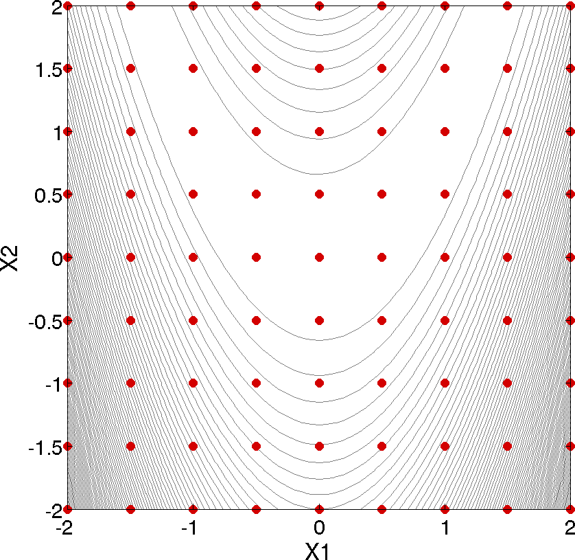

.. _helloworld-main:

""""""""""""""""""""""""""""""""""""
Tutorial: Your First Dakota Study
""""""""""""""""""""""""""""""""""""

In this tutorial you run three different Dakota studies: with a function built into
Dakota (a direct interface), with the same function run as a black-box simulation through
an analysis driver, and with the same analysis driver but changing the method.

**Prerequisites:** Dakota installed, with its ``bin`` folder on your ``PATH``
(see :ref:`setupdakota-installation` and :ref:`setupdakota-environment`).
For Part B you also need Python 3, with Dakota's Python folder on your
``PYTHONPATH``.

The example throughout is Rosenbrock's function of two variables, ``x1`` and
``x2``. If you haven't been introduced to it yet, see :ref:`studyanatomy-rosenbrock`.

Every input file below is shown in both of Dakota's input formats. Choose the
:guilabel:`JSON` or :guilabel:`Freeform` tab, and the whole page follows your
choice.

..
   TODO (regret): the tutorial's input files and drivers are shown inline. Ship
   them in dakota-examples with regression tests, and literalinclude them.

.. _helloworld-parta:

===============================
Part A: Run a built-in example
===============================

1. Check that Dakota runs. This command prints Dakota's version:

   .. code-block:: console

      dakota -v

2. Create an empty folder for this part, and open a terminal in it.

3. Create the input file:

   .. tab:: JSON

      Save this as ``rosen_multidim.json``:

      .. code-block:: json

         {
           "environment": {
             "tabular_data": {
               "tabular_data_file": "rosen_multidim.dat"
             }
           },
           "method": [
             {
               "multidim_parameter_study": {
                 "partitions": [8, 8]
               }
             }
           ],
           "model": [
             {
               "single": {}
             }
           ],
           "variables": [
             {
               "continuous_design": {
                 "count": 2,
                 "descriptors": ["x1", "x2"],
                 "lower_bounds": [-2.0, -2.0],
                 "upper_bounds": [2.0, 2.0]
               }
             }
           ],
           "interface": [
             {
               "analysis_drivers": {
                 "drivers": ["rosenbrock"],
                 "interface_type": {
                   "direct": {}
                 }
               }
             }
           ],
           "responses": [
             {
               "gradient_type": {
                 "no_gradients": true
               },
               "hessian_type": {
                 "no_hessians": true
               },
               "response_type": {
                 "response_functions": {
                   "count": 1
                 }
               }
             }
           ]
         }

   .. tab:: Freeform

      Copy ``rosen_multidim.in`` from the ``share/dakota/examples/users/``
      folder of your Dakota installation, or save this as
      ``rosen_multidim.in``:

      .. literalinclude:: ../samples/rosen_multidim.in
         :language: dakota
         :tab-width: 2

   It describes an 81-point grid study of Rosenbrock's function, using the
   copy of the function built into Dakota. :ref:`studyanatomy-main` explains
   each block.

4. Run Dakota:

   .. tab:: JSON

      .. code-block:: console

         dakota -json rosen_multidim.json -o rosen_multidim.out > rosen_multidim.stdout

   .. tab:: Freeform

      .. code-block:: console

         dakota -i rosen_multidim.in -o rosen_multidim.out > rosen_multidim.stdout

.. _helloworld-results:

What happened
-------------

Dakota ran Rosenbrock's function 81 times and wrote four files:

- ``rosen_multidim.stdout``: Dakota's progress messages, which would
  otherwise appear on the screen.
- ``rosen_multidim.out``: details of each evaluation, and a summary at the
  end.
- ``rosen_multidim.dat``: the :term:`tabular data file`, with one row per
  evaluation. Its first rows are:

  .. code-block:: none

     %eval_id interface             x1             x2  response_fn_1
     1            NO_ID             -2             -2           3609
     2            NO_ID           -1.5             -2         1812.5
     3            NO_ID             -1             -2            904

- ``dakota.rst``: a binary :term:`restart file`. If a study is interrupted,
  Dakota can use it to continue without repeating finished evaluations.

The 81 points form a 9 × 9 grid over the range of ``x1`` and ``x2``:

         drawn over a contour plot of Rosenbrock's function.
   :align: center
   :width: 400

   The points evaluated by the grid study.

You can open the tabular data file in a spreadsheet or plotting tool to
explore the results. :ref:`output` describes all of Dakota's output files.

.. _helloworld-partb:

========================================
Part B: The same problem as a black box
========================================

Now run the same study, but Dakota treats Rosenbrock's function as a
:term:`black box`: a separate program that reads an input file and writes an
output file, like an engineering simulation code. Dakota connects to it
through an :term:`analysis driver`. :ref:`couplingtosimulations-main` explains
the ideas behind each step.

1. Create a new, empty folder for this part, open a terminal in it, and copy
   in the black-box simulation and its input template from your Dakota
   installation:

   .. tab:: Linux / macOS

      .. code-block:: console

         cp <install_dir>/share/dakota/examples/official/drivers/bash/templatedir/* .

   .. tab:: Windows

      .. code-block:: powershell

         Copy-Item "<install_dir>\share\dakota\examples\official\drivers\bash\templatedir\*" .

   Replace ``<install_dir>`` with the folder where you installed Dakota. You
   now have two files:

   - ``rosenbrock_bb.py``, the simulation. It reads an input deck,
     ``ros.in``, and writes a log, ``ros.out``.
   - ``ros.template``, a copy of the input deck with ``{x1}`` and ``{x2}``
     where the variable values go.

2. Save one of these analysis drivers in the same folder, as ``driver.py``,
   ``driver.sh`` or ``driver.ps1``:

   .. include:: analysis_driver_tabs.inc

   On Linux and macOS, make a Bash driver executable with
   ``chmod +x driver.sh``.

3. Test the analysis driver by hand. Save this sample parameters file as
   ``params.in``. It is what Dakota writes for the first evaluation, where
   ``x1`` and ``x2`` are both -2:

   .. code-block:: none

                               2 variables
          -2.000000000000000e+00 x1
          -2.000000000000000e+00 x2
                               1 functions
                               1 ASV_1:response_fn_1
                               2 derivative_variables
                               1 DVV_1:x1
                               2 DVV_2:x2
                               0 analysis_components
                               1 eval_id

   Then run your analysis driver on it:

   .. tab:: Python

      .. code-block:: console

         python3 driver.py params.in results.out

   .. tab:: Bash

      .. code-block:: console

         ./driver.sh params.in results.out

   .. tab:: Windows (PowerShell)

      .. code-block:: console

         powershell.exe -File driver.ps1 params.in results.out

   Look at the files the driver created:

   - ``ros.in``: the template, with -2 filled in for both variables;
   - ``ros.out``: the simulation's log, including the line
     ``Function value =  3.6090000000000000e+03``;
   - ``results.out``: the value 3609, ready for Dakota.

   If something goes wrong, see :ref:`couplingtosimulations-testing`.

4. Create the input file. It is the same as Part A's, except for the
   highlighted interface block, which now runs your analysis driver:

   .. tab:: JSON

      Save this as ``rosen_blackbox.json``:

      .. code-block:: json
         :emphasize-lines: 29-38

         {
           "environment": {
             "tabular_data": {
               "tabular_data_file": "rosen_multidim.dat"
             }
           },
           "method": [
             {
               "multidim_parameter_study": {
                 "partitions": [8, 8]
               }
             }
           ],
           "model": [
             {
               "single": {}
             }
           ],
           "variables": [
             {
               "continuous_design": {
                 "count": 2,
                 "descriptors": ["x1", "x2"],
                 "lower_bounds": [-2.0, -2.0],
                 "upper_bounds": [2.0, 2.0]
               }
             }
           ],
           "interface": [
             {
               "analysis_drivers": {
                 "drivers": ["python3 driver.py"],
                 "interface_type": {
                   "fork": {}
                 }
               }
             }
           ],
           "responses": [
             {
               "gradient_type": {
                 "no_gradients": true
               },
               "hessian_type": {
                 "no_hessians": true
               },
               "response_type": {
                 "response_functions": {
                   "count": 1
                 }
               }
             }
           ]
         }

   .. tab:: Freeform

      Save this as ``rosen_blackbox.in``:

      .. code-block:: dakota
         :emphasize-lines: 18-20

         environment
           tabular_data
             tabular_data_file = 'rosen_multidim.dat'

         method
           multidim_parameter_study
             partitions = 8 8

         model
           single

         variables
           continuous_design = 2
             lower_bounds     -2.0     -2.0
             upper_bounds      2.0      2.0
             descriptors       'x1'     'x2'

         interface
           analysis_drivers = 'python3 driver.py'
             fork

         responses
           response_functions = 1
           no_gradients
           no_hessians

   If you saved the Bash or PowerShell driver, change the ``analysis_drivers``
   value to ``'driver.sh'`` or ``'powershell.exe -File driver.ps1'``.

5. Run Dakota:

   .. tab:: JSON

      .. code-block:: console

         dakota -json rosen_blackbox.json -o rosen_blackbox.out > rosen_blackbox.stdout

   .. tab:: Freeform

      .. code-block:: console

         dakota -i rosen_blackbox.in -o rosen_blackbox.out > rosen_blackbox.stdout

6. Compare ``rosen_multidim.dat`` in this folder with the one from Part A.
   The values are the same: Dakota ran the black-box simulation 81 times
   through your analysis driver, and got the same answers as the built-in
   function.

.. _helloworld-partc:

====================================
Part C: One interface, many methods 
====================================

Your analysis driver works with any Dakota method. In the Part B folder,
replace the method block of your input file with this one, and leave
everything else unchanged:

.. tab:: JSON

   .. code-block:: json

      {
        "method": [
          {
            "sampling": {
              "samples": 20,
              "seed": 52983
            }
          }
        ]
      }

.. tab:: Freeform

   .. code-block:: dakota

      method
        sampling
          samples = 20
          seed = 52983

Run Dakota again with the same command as in Part B. Instead of a grid,
:dakkw:`method-sampling` runs 20 points spread through the range of ``x1``
and ``x2`` by Latin hypercube sampling. The new ``rosen_multidim.dat`` has 20
rows. Fixing the ``seed`` makes the points the same each time you run.

You changed the method without touching your code or your analysis driver.
That is the main idea behind Dakota: build one interface, then use many
methods. To see which methods Dakota offers, and which questions each kind of
study answers, see :ref:`studytypes-main`.

.. _helloworld-next:

==========
Next steps
==========

- :ref:`examples-gettingstarted-main` runs more studies on Rosenbrock's
  function, including optimization.
- The :ref:`cantilever beam example <additional:cantilever>` is a more
  realistic engineering problem, with several responses.
- To connect your own code, start from your analysis driver in Part B, and
  see :ref:`couplingtosimulations-main`.

===============
Video Resources
===============

**Next:** :ref:`studytypes-main`
